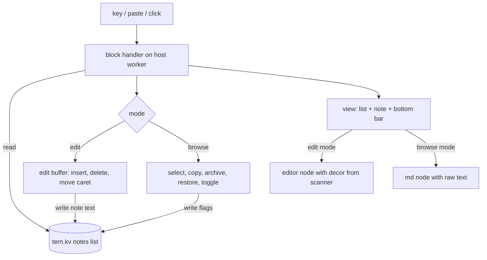

# Scratchpad Notes Capture - Plan

## Goal Capsule

- **Objective:** A developer working beside a coding agent can capture a follow-up idea inside Tern in one action, find it again on any later run, and never expose it to the agent working in the repo.
- **Product authority:** The decisions the user confirmed in the brainstorm dialogue. Where this plan and the starter plugin in the repo disagree, this plan wins.
- **Current area:** Text capture with Markdown, plus the list that holds the notes. Acting on notes later (handing them to an agent, search, delete) is not active scope.
- **Means:** A block that keeps notes in the plugin's own key-value store and edits them over Tern's `editor` field with native editing on (`features = { "edit" }`): Tern supplies caret placement and selection, and the block applies typed keys itself (KTD1, KTD3, KTD10).
- **Stop conditions:** Stop and ask if notes would have to be written under any project path, or if Tern gives plugin blocks no way to receive typed text.
- **Open blockers:** None. U0 ran and the user chose native editing (KTD10).

---

## Product Contract

### Summary

Scratchpad is a pane inside Tern. Notes are listed on the left and the selected note is on the right.
Opening it lands on a new empty note, ready to type or paste, and Markdown formats itself in place as you type.
Notes persist in Tern's own storage outside any project, and you can edit, copy, archive and restore them, by key or by mouse.

### Problem Frame

Follow-up ideas arrive mid-task, usually as one or two sentences, and each place to put them has a cost.
Memory loses them. Telling the agent derails the task it is on. A Markdown or text file in the repo gets found by the agent, which then gets confused by it. A separate notes app means leaving Tern.

The need is a place inside Tern that takes a thought in seconds and sits where an agent reading the repo cannot see it.

### Key Decisions

- **List-and-note pane.** Notes are listed on the left and the selected note is on the right, with no separate preview box. (session-settled: user-directed — chosen over a bottom composer with the preview beside or stacked above it: the user wants a browsable list and one editing area.) Governs R7, R8.
- **Markdown styles itself as you type.** Formatting appears as soon as a span becomes valid, the way Tern's own composer behaves. (session-settled: user-directed — chosen over plain text while editing with rendering only when done: the user expects modern-editor behavior.) Governs R4, R5.
- **A finished note shows fully rendered Markdown.** The styled editor is for typing and the rendered view is for reading. (session-settled: user-approved — proposed alongside the styled editor with the tradeoff that Tern's editor cannot hide delimiters; the user confirmed.) Governs R6.
- **Opening Scratchpad lands on a new empty note.** (session-settled: user-directed — chosen over resuming the last note or showing the list: capture is the moment the user is afraid of forgetting.) Governs R1.
- **Archived notes are hidden, with a key to show them.** (session-settled: user-directed — chosen over dimming them in the list or hiding them with no way back: keeps the list short while archived notes stay reachable, since delete is out of scope.) Governs R10.
- **Notes save as you type, with no discard.** (session-settled: user-approved — proposed in the scope synthesis and confirmed.) Governs R3.
- **One list across all projects and windows.** (session-settled: user-approved — proposed in the scope synthesis and confirmed.) Governs R11.
- **Copy puts raw Markdown on the clipboard.** (session-settled: user-approved — proposed in the scope synthesis and confirmed.) Governs R9.
- **Storage stays outside every project directory.** The user's constraint is that notes never pollute the agent's context. Governs R12.

### Requirements

**Capture**

- R1. Invoking Scratchpad from the palette or a key binding shows the pane with a new empty note focused and ready for input.
- R2. Typed text and pasted text, including multi-line paste, both go into the focused note as entered, except that pasted line breaks are stored as LF.
- R3. A note is saved as it is typed, so closing the pane or restarting Tern loses nothing, and a new note that never received text is not kept.
- R14. A note whose text is deleted down to nothing and then finished is dropped, like a note that never received text.

**Markdown**

- R4. While a note is being edited, Markdown formats in place as soon as a span is valid, with the delimiters left visible but dimmed. The supported set is bold, italic, inline code, headings, lists, links and fenced code.
- R5. Text that is not valid or not in the supported set shows as plain text while editing.
- R6. Finishing a note with an explicit key shows it fully rendered, with delimiters hidden, and Enter returns to editing. Selecting a note from the list shows it in this rendered state.

**Notes list**

- R7. The pane lists every non-archived note on the left, newest created first, with the selected note's content on the right. With no notes, the list shows "No notes yet".
- R8. A selected note can be edited: Enter switches it to the styled editor and finishing returns it to the rendered view. The list and the open note are separate focus zones: while a note is in the styled editor, arrow keys move the caret, and the list is reached by finishing the note. Selecting another note finishes the current one first.
- R9. A key copies the selected note's raw Markdown to the clipboard and shows a brief toast on success or failure.
- R10. A key marks the selected note archived and removes it from the list; the next note in the list (the previous one if it was last) becomes selected and shows rendered, or a new empty note opens when none remain. A key toggles the list between active and archived notes only, showing "No archived notes" when that view is empty. A key on a selected archived note restores it to the main list in its newest-first position.
- R13. Every action a key performs can also be performed with the pointer.
  - Clicking a list row selects that note and shows it rendered, finishing any edit in progress.
  - Clicking the rendered note starts editing it.
  - A bottom bar of controls covers new note, edit or finish, copy, archive or restore, and show or hide archived, each showing its key.

**Persistence and isolation**

- R11. Notes persist across Tern restarts, plugin reloads and closed windows. Every window and every Scratchpad pane shows the same notes; a pane that is already open shows another pane's change from its next key or click.
- R12. Notes are stored in Tern's own plugin data location and never in a project directory or any path an agent working in a repository would scan.

### Key Flows

- F1. Capture an idea
  - **Trigger:** An idea arrives while an agent works in another pane.
  - **Steps:** The user invokes Scratchpad and a new empty note is focused. They type or paste the idea, then finish the note and return to the work.
  - **Outcome:** The note is in the list and the repo is unchanged.
  - **Covered by:** R1, R2, R3, R4, R6, R12

- F2. Revisit a note
  - **Trigger:** The user opens Scratchpad later, in the same or a new run.
  - **Steps:** The user selects a note and reads it rendered. They then edit it, copy its Markdown, or archive it.
  - **Outcome:** The note changes or leaves the main list, and the change is there on the next run.
  - **Covered by:** R6, R7, R8, R9, R10, R11

### Acceptance Examples

- AE1. **Covers R1, R3, R11.** Given Scratchpad is closed, when the user invokes it, types a sentence, closes the pane and restarts Tern, then reopening Scratchpad lists that note.
- AE2. **Covers R3.** Given Scratchpad opened on a new empty note, when the user closes it without typing, then no empty note appears in the list.
- AE3. **Covers R4, R5.** Given the user types `**done` in a note, then it shows as plain text. When they type the closing `**`, then `done` appears bold and both pairs of asterisks stay visible and dimmed.
- AE4. **Covers R6, R8.** Given a note being edited, when the user finishes it, then it shows rendered with no delimiters. When they press Enter, then the styled editor returns with the same text.
- AE5. **Covers R10.** Given a note, when the user archives it, then it leaves the list and the next note in the list is selected and shown rendered. When they show archived notes, then only archived notes are listed, the note appears there, and restoring it returns it to the main list.
- AE6. **Covers R11, R12.** Given notes captured while working in a repository, when the repository's working tree is checked, then it holds no new or changed files, and a second Tern window lists the same notes.
- AE7. **Covers R13.** Given two notes with one open in the styled editor, when the user clicks the other note's row, then the first note is saved and finished and the other shows rendered. When they click the rendered note, then the styled editor opens on it. When they click the archive control, then the note is archived as AE5 describes.

### Scope Boundaries

Deferred for later:

- Deleting notes. Archived notes stay in storage indefinitely until this exists.
- Searching or filtering the list.
- One-line quick capture straight from the palette.
- Separating notes by project.
- Exporting notes to files.

### Dependencies / Assumptions

- Tern's `editor` field styles text but cannot hide it or change its size, so R4 shows delimiters and gives headings weight and color only (`https://docs.stencil.so/tern/elements/input.md`).
- Tern's published docs say plugin blocks advertise no native-editing features, but `tern.d.luau` `BlockDef` declares `features`, and U0 observed that `features = { "edit" }` works (see U0 outcome). Typed characters, Enter, Backspace, Delete and arrows still arrive as `key` calls; click, selection and selection edits arrive as `edit` events. R2 and R4 rest on this.
- The `editor` node kind is documented only on the published site and is absent from `tern.d.luau`, so its props are taken from the docs.
- Typical notes are one or two sentences. Large pastes are possible but not designed for.
- `tern.kv` lives on the machine whose panes the host half serves, so a pane running on a remote host keeps its own list there. "One list" means one per machine; remote use is not designed for.

### Outstanding Questions

#### Decided After U0

- Native editing, adopted after U0 with no hand-built fallback (no setting dependency was found). `undo` is not enabled. See U0 and KTD10.

#### Deferred to Implementation

- Which global chord opens Scratchpad without colliding with a Tern default.
- The key name Tern reports for Escape, and whether Tern consumes any of the chosen keys before the block sees them.
- Whether pasting a very large text is slow enough to notice; no size limit is planned.

### Sources / Research

- `tern.d.luau`: `tern.kv` and plugin data directory (lines 27-30, 1816-1825), `BlockDef` (271-292), `tern.ui.md` (1909-1910), window `new_block` (1616).
- Tern block guide: `https://docs.stencil.so/tern/guides/blocks.md`.
- Tern input elements, including the editor and a note-composer snippet: `https://docs.stencil.so/tern/elements/input.md`.
- Starting-point example, a block with keys, saved state, a palette command and a key bind: `https://docs.stencil.so/tern/examples/review-queue.md`.
- Repo state: `plugin.toml`, `host.luau` and `window.luau` still hold only the starter `seq` lens and `hello` command, with no `[[blocks]]` entry. `AGENTS.md` sets the Luau conventions and the host/window split.

---

## Planning Contract

Product Contract preservation: changed. R13 and R14 are added, R7 gains "created" ordering, R2 states that pasted line breaks are stored as LF, and R11 holds for an open pane from its next key or click. All come from the user's confirmed scoping or review; no R-ID was renumbered, and the Deferred to Planning questions are now answered by KTD1 through KTD9.

### Key Technical Decisions

- KTD1. Notes are one list in the plugin key-value store under a single key, as `{ id, text, archived }` entries plus an id counter. The store is `<data>/kv.json` in the plugin data directory, shared by every window, so it meets R11 and R12 with no code of ours (`tern.d.luau` `tern.kv`, `tern.plugin.data`). Chosen over a key per note, which needs a separate index to stay consistent, and over files in the data directory, which add parsing for nothing. Rewriting the whole list on each keystroke is acceptable for notes of a few sentences.
- KTD2. The store is the source of truth and block state holds only view state: selected note id, mode, caret. Every handler reads the note from the store before acting and writes through it. Handlers of one plugin serialize on a single host worker thread, so a read-modify-write cannot interleave with another pane's. That holds per host VM: a window with no daemon runs its own host runtime, and across VMs the last write wins. A stale pane picks up the newer text on its next handler. The caret is clamped to the text it finds.
- KTD3. Editing uses native editing on `tern.ui.node("editor", …)` with `features = { "edit" }`. Note text lives in the store (KTD2); the block keeps only the caret, mode and selected id. Typed keys, Backspace, Delete and arrows arrive as `key` calls and are applied by `editbuf.luau` at the caret; a native selection, click or Home/End arrives as an `edit` event `{ from, to, text, cursor, len }` in UTF-16 offsets, applied to the stored text (ignored when `len` does not match, which marks it stale). The field is shown with `text`, `cursor` and `decor`. The block's offsets are UTF-8 byte offsets on character boundaries, converted to UTF-16 for `cursor`, `decor` and events. No `anchor` is used.
- KTD4. Live styling is a pure scanner over the note text that returns `decor` spans: delimiters as `dim`, content as `strong`, `em` or `code`, headings as `strong accent`, link text as `link`. It rescans the whole note per keystroke. An unclosed or unsupported span yields no decoration, which is R5. Nested emphasis is not recognised.
- KTD5. The rendered view is `tern.ui.md` over the raw text, so R6 needs no renderer of ours.
- KTD6. Pointer input uses node `actions = { click = "<act>=<value>" }`, answered in the block's `event` handler by `ev.act` and `ev.value`, the pattern in the Tern checklist example (`https://docs.stencil.so/tern/guides/blocks.md`). The bottom bar is a `dock` region of clickable badges carrying keycap hints.
- KTD7. Each invocation opens a new pane with `cx:new_block("scratchpad.notes")`. There is no pane reuse, because every pane reads the same store (KTD2) and reuse would need a pane lookup for no user-visible gain. This is cheap to change later.
- KTD8. The list is ordered by note id, descending, so a note never moves while it is edited. A row shows the first non-empty line of the note, left to Tern's list to truncate.
- KTD9. The block has two modes. In browse mode `j`/`k` and the arrows move, Enter edits, `n` starts a new note, `y` copies, `a` archives or restores, `v` toggles the archived view. In edit mode, typed text, paste, Enter, Backspace, Delete, arrows and Home/End edit the note and Escape finishes it. Up and Down move between logical lines, so a soft-wrapped line moves as one. Ctrl and cmd chords are either consumed by the block or unused; the block does not assume that ignoring a key returns it to Tern (U5). This settles R8's focus zones.
- KTD10. The user chose native editing after U0 reported, with the least hand-written code: `editbuf.luau` keeps only the key-driven edits and the UTF-8/UTF-16 conversion.

### High-Level Technical Design

### Scope Boundaries (planning)

Considered and not built:

- Undo. `undo` is not declared in `features`, so ⌃Z does nothing; revisit if wanted.
- Debounced or batched writes. One small value is rewritten per keystroke; revisit if typing in a long note lags.
- Pane reuse and cross-pane live refresh of an open note. A pane sees other panes' changes on its next key or click, so R11 holds from that point. Whether Tern gives a block a refresh signal is not established.

### Risks and Dependencies

- The `editor` node and span tokens are documented only on the published site, not in `tern.d.luau`, so a prop may behave differently than documented. U5's smoke run is the first check.
- Offsets in UTF-16 versus bytes can put the caret or a style off by one on emoji and accented text. U3 owns the conversion and its scenarios cover both.
- `luau-lsp` and `luau` are not installed, so type errors in the new modules surface only when Tern loads the plugin. Run `tern plugin reload` after each unit.
- `ctl` and headless sessions come from the Tern CLI installed here; the smoke script depends on its `serve`, key, type and click commands.

---

## Implementation Units

### U0. Native-editing check (decision gate)

- **Goal:** Establish whether Tern gives a plugin block native text editing, so the user can decide the editing mechanism before U3 and U5 are built.
- **Requirements:** R2, R4, R13.
- **Dependencies:** none.
- **Files:** none kept. This is a throwaway probe block, removed once the observations are recorded.
- **Approach:**
  - Define a temporary block with `features = { "edit", "undo" }` holding one `editor` node with sample text and a `decor` span. Drive it in a headless session with `tern ctl` (typed text, click, shift-arrow, undo, paste) and record what the block's `key` and `event` handlers receive.
  - Record each factor below as observed, not inferred from the docs. Run once with Settings > Terminal > Native composer editing on and once with it off.
  - Stop after recording and report to the user. Do not start U3 or U5 until the user picks the path; U1, U2 and U4 do not depend on it.
- **Decision factors:**
  - Do `edit` events reach the block's `event` handler, with the payload the docs describe (`from`, `to`, `text`, `cursor`, `len`)? (Docs: plugin blocks advertise no features, so none arrive.)
  - Does a click inside the editor place the caret, and is mouse selection available?
  - Does `undo` arrive on ⌃Z, and does `decor` styling still render while editing?
  - Does the native path depend on the user's Native composer editing setting? If it does, a user with the setting off gets no typing, so the hand-built editor stays as a fallback and U3 is still built.
  - How much of U3 the native path removes, and whether R4's styling, paste handling and the UTF-16 offsets still need our code.
- **Outcomes:**
  - **Native works, with no setting dependency:** the user decides whether to adopt it. Adopting drops U3, restores mouse caret, selection and undo to scope, and updates R13, KTD3 and Scope Boundaries.
  - **Native works only with the setting on:** the user decides between native with a hand-built fallback (U3 stays, so more code) and hand-built only (the current plan).
  - **Native does not work:** continue with the hand-built plan unchanged; the accepted limits stand.
- **Recorded outcome (headless probe, since removed):** native editing works for plugin blocks with `features = { "edit" }`, contrary to the published docs. Typed characters, Backspace, Left and Escape arrive as `key` calls. After a native selection (⇧-arrows, ⌘A), typing or Backspace arrives as an `edit` event `{ from, to, text, cursor, len }` in UTF-16 offsets. A click or Home/End arrives as a zero-width `edit` event that moves the caret. ⌃Z arrives as an `undo` event only when `undo` is declared. The Native composer editing setting was not tested. The user chose native editing (KTD10); U3 shrank to key-driven edits plus offset conversion.
- **Test scenarios:** none -- this is a probe whose output is a recorded observation set.
- **Verification:** The decision factors are each answered with an observed result and presented to the user.

### U1. Note storage

- **Goal:** Read, create, update, archive, restore and drop notes in the key-value store.
- **Requirements:** R3, R10, R11, R12, R14.
- **Dependencies:** none.
- **Files:** `notes.luau` (create).
- **Approach:**
  - Expose list-by-view (active or archived, newest first), get by id, create with the next id, set text, set archived, and drop.
  - Setting a note's text never drops it. A note is created on its first non-empty text, and an explicit drop, called only by the finish path in U5, removes a note (KTD1, KTD2, R14).
  - Wrap the list with `tern.json.array` so an empty list stays a JSON array.
- **Patterns to follow:** `tern.kv` usage in the Tern io guide (`https://docs.stencil.so/tern/guides/io.md`).
- **Test scenarios:**
  - Covers AE1. Create a note with text, reload the plugin, and the note is still listed.
  - Covers AE2. Open a block, never type, close it, and the list is empty.
  - Two notes created in order list newest first; editing the older one leaves the order unchanged.
  - Covers R14. A text write that leaves a note empty keeps it in the store; dropping it is a separate call, after which it is in neither view.
  - Covers AE5. Archive moves a note to the archived view; restore returns it to its created position among active notes.
  - Covers AE6. The kv file is under the plugin data directory and the repository working tree is unchanged.
- **Verification:** Notes survive `tern plugin reload` and a Tern restart.

### U2. Markdown scanner

- **Goal:** Turn note text into `decor` spans for bold, italic, inline code, headings, lists, links and fenced code.
- **Requirements:** R4, R5.
- **Dependencies:** none.
- **Files:** `markdown.luau` (create).
- **Approach:**
  - Scan line by line, tracking fenced code, then inline spans within a line (KTD4).
  - Return byte ranges and token strings; U3's converter turns them into UTF-16.
- **Test scenarios:**
  - Covers AE3. `**done` returns no spans; `**done**` returns `done` as strong and both `**` pairs dim.
  - `*a*`, `` `x` `` and `[t](u)` each produce their spans.
  - `# Title` styles the heading and dims the marker; `- item` dims the bullet.
  - A fenced block styles its body as code until the closing fence, and an unclosed fence styles to the end.
  - Nested `**a *b* c**` falls back to plain text rather than wrong spans.
  - Empty text and a lone `*` return no spans.
- **Verification:** The styled editor in U5 shows each case with no mis-ranged style.

### U3. Edit buffer

- **Goal:** Apply typing, paste, deletion and caret movement to text, and convert offsets for the editor node.
- **Requirements:** R2.
- **Dependencies:** U0 (outcome: native adopted). Still built, but only for the key-driven edits and the UTF-8/UTF-16 conversion; selection edits come from Tern's `edit` events.
- **Files:** `editbuf.luau` (create).
- **Approach:**
  - Operations: insert text at the caret, backspace, delete, left, right, up, down, home, end (KTD3, KTD9).
  - Treat a character as one UTF-8 sequence for movement and deletion.
  - Convert a byte offset to a UTF-16 offset, counting code points above U+FFFF as two.
- **Test scenarios:**
  - Insert in the middle of text puts the text at the caret and moves the caret after it.
  - Backspace at the start and Delete at the end change nothing.
  - Backspace over `é` and over an emoji removes the whole character.
  - Up and Down keep the column, clamp on a shorter line, and stop at the first and last line.
  - Multi-line paste with `\r\n` is inserted as it arrives with line breaks normalised to `\n`.
  - The UTF-16 offset after an emoji is two more than its character count.
- **Verification:** Typing, deleting and moving over mixed ASCII, accented and emoji text keeps the caret where the user expects in U5's smoke run.

### U4. Scratchpad block: list, rendered note, bar, pointer

- **Goal:** Define the `scratchpad.notes` block with its browse mode, pointer input and persistence wiring.
- **Requirements:** R1, R6, R7, R9, R10, R11, R13.
- **Dependencies:** U1.
- **Files:** `host.luau` (modify; the `seq` lens stays), `plugin.toml` (modify).
- **Approach:**
  - Add the `[[blocks]]` entry with id `notes` and title `Scratchpad`; define the block next to the lens with `tern.block.define("notes", …)` and annotate it `BlockDef<State>`.
  - `init` opens on a new unsaved note in edit mode (R1, AE2); view state is not returned from `save`.
  - `view` returns `main` with the list on the left and the selected note on the right, and a `dock` bar of controls (KTD5, KTD6, KTD8).
  - Browse keys and the click actions from KTD6 share one set of handler functions so key and click cannot drift.
  - Archive selects the next note in the list, or the previous one if the archived note was last, and opens a new empty note only when none remain (R10); copy calls `cx:copy` and toasts the result.
- **Patterns to follow:** The checklist block in `https://docs.stencil.so/tern/guides/blocks.md`.
- **Test scenarios:**
  - Covers AE5. Archive the selected note by key and again by click: the next note is selected rendered, the archived view lists only archived notes, restore returns it.
  - Covers AE7. Click another row while one note is open: selection moves and the rendered view shows.
  - Empty store shows "No notes yet"; empty archived view shows "No archived notes".
  - Copy puts the raw Markdown, delimiters included, on the clipboard and toasts.
  - Covers AE6. Two panes list the same notes after one creates a note and the other presses a key.
- **Verification:** Every control in the bar works by key and by click.

### U5. Edit mode

- **Goal:** Typing, paste and live styling in the note area.
- **Requirements:** R2, R3, R4, R5, R6, R8, R14.
- **Dependencies:** U0 (outcome), U2, U3, U4.
- **Files:** `host.luau` (modify).
- **Approach:**
  - Set `features = { "edit" }` (no `undo`). Typed keys, `paste`, Enter, Backspace, Delete, arrows, Home and End go through U3's key-driven edits; `edit` events (selection, click, Home/End) are applied to the stored text through `editbuf.apply_edit`, ignoring an event whose `len` does not match the current text. Every change is written through U1 (KTD2).
  - In edit mode render an `editor` node with the note text, UTF-16 `cursor`, `decor` from U2 converted by U3, and a placeholder on an empty note.
  - Escape, a row click or the finish control returns to browse mode and the rendered view; finishing an emptied note calls U1's drop (R14).
  - List every ctrl or cmd chord the block consumes. Tern's guide says a key the handler ignores is not passed anywhere else, so the block does not rely on returning false to hand a chord back. A smoke check confirms the U6 open chord still works while a Scratchpad pane is focused.
- **Execution note:** Prefer a smoke run on each key family as it is wired; the `editor` props are documented only on the published site.
- **Test scenarios:**
  - Covers AE1. Type a sentence, close the pane, restart Tern, and the note is listed.
  - Covers AE3. Typing `**done` shows plain text; typing the closing `**` styles it with dim delimiters.
  - Covers AE4. Escape shows the note rendered with no delimiters; Enter returns the editor with the same text.
  - Multi-line paste arrives in the note as pasted, in order.
  - Delete all text and finish: the note disappears from the list (R14).
  - Typing `é` and an emoji, then moving left and typing again, inserts at the right place.
  - Clicking inside the editor places the caret there, and typing then inserts at that position.
- **Verification:** The full F1 flow works with no mouse, and F2 works with only the mouse.

### U6. Palette command and key binding

- **Goal:** Open Scratchpad from the palette and a global chord.
- **Requirements:** R1.
- **Dependencies:** U4.
- **Files:** `window.luau` (modify; the `hello` command stays), `plugin.toml` (already declares `window`).
- **Approach:** Add `tern.command` with id `open`, title "Open Scratchpad" and a default `keys` chord, whose `run` calls `cx:new_block("scratchpad.notes")` (KTD7). The block's own "New Scratchpad block" palette row also exists, so both invocation routes work.
- **Test scenarios:**
  - Covers AE1. The chord and the palette command each open a pane that lands on a new empty note.
  - Invoking twice opens two panes that show the same notes.
- **Verification:** `tern plugin list` shows `scratchpad` ready with the new command.

### U7. Smoke script and repo guide

- **Goal:** Make the checks above repeatable and keep `AGENTS.md` true.
- **Requirements:** R1 to R14, as exercised by the smoke runs.
- **Dependencies:** U1 to U6.
- **Files:** `scripts/smoke.sh` (create), `AGENTS.md` (modify).
- **Approach:**
  - The script starts a headless Tern session with the `plugins fixtures` scenario command, because headless runs load plugins only through it. It sends keys, text and clicks through `tern ctl`, and checks output and screenshots for AE1 to AE7.
  - Update `AGENTS.md`: the new block, `[[blocks]]` entry and modules, the kv store, the pointer pattern, and the smoke script as the QA path.
- **Test expectation:** none -- this unit is the harness for the others.
- **Verification:** The script runs clean from a fresh session.

---

## Verification Contract

| Check | Command | Applies to |
| --- | --- | --- |
| Plugin loads | `tern plugin reload`, then `tern plugin list` shows `scratchpad` ready | every unit |
| Types | `luau-lsp analyze --platform=standard --definitions=@tern=tern.d.luau host.luau window.luau notes.luau markdown.luau editbuf.luau` when `luau-lsp` is installed | every unit |
| Behavior | U4 to U6 by manual `tern ctl` runs against each unit's own Verification line; `scripts/smoke.sh` for the whole of AE1 to AE7 | U4 to U6; U7 |
| Isolation | The repository working tree is unchanged after capturing notes (AE6) | U1, U7 |

---

## Definition of Done

- AE1 to AE7 pass, run by `scripts/smoke.sh`, and the starter `seq` lens and `hello` command still work.
- No note data is written inside the repository or any project path.
- `AGENTS.md` describes the block, modules, storage and pointer pattern.
- No throwaway code from abandoned attempts remains in the diff.
